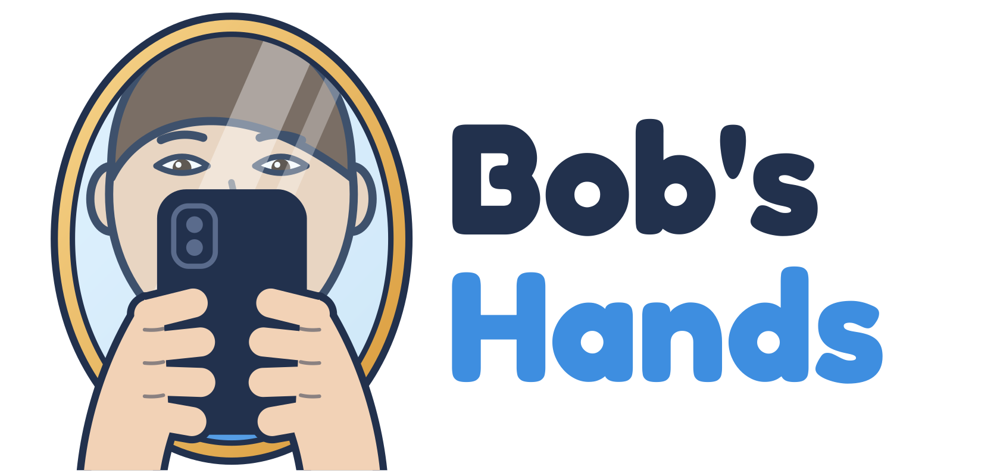

  

# Bob's Hands

> **Les mains et les yeux de celles et ceux qui ne peuvent pas toucher leur téléphone.**

*Bob's Hands* est une application Android d'assistant vocal pensée pour les personnes en situation de handicap moteur (tétraplégie, personnes alitées, mobilité très réduite) et pour les personnes aveugles ou malvoyantes.

La personne n'a plus jamais besoin de toucher son téléphone : **tout se pilote à la voix, absolument tout, réglages compris.**

---

## En quelques mots

Au cœur de l'application, il y a **Bob**, un compagnon qu'on réveille en disant simplement « Bob » ou « Hey Bob ».

- **Bob est les mains** de la personne : il ouvre les applis, navigue, écrit des messages, envoie des mails, cherche des fichiers, règle le volume ou la luminosité.
- **Bob est les yeux** de la personne : il lit à voix haute les mails et les messages, décrit ce qui s'affiche, lit le courrier ou une boîte de médicaments présentés à la caméra, reconnaît les couleurs, les objets, les billets de banque.
- **Bob est un ami** : une voix douce et chaleureuse, qui sent l'humeur de la personne, plaisante au bon moment, propose un petit jeu quand le moral baisse, et devient avec le temps un compagnon unique.

Bob s'affiche à l'écran sous la forme d'un **personnage expressif** (au choix parmi plusieurs) qui change de visage selon ce qu'il dit. *Bob's Hands* est un **launcher** : il remplace l'écran d'accueil du téléphone.

## Ce que Bob n'est pas

- **Pas un assistant domotique.** Une personne alitée à l'hôpital n'a pas besoin d'éteindre la lumière : l'infirmière le fait. Son vrai besoin, c'est le **lien avec le monde** : écrire à sa fille, écouter de la musique, lire ses mails, avoir de la compagnie.
- **Pas un service payant.** L'application est et restera gratuite, complète, pour tout le monde.
- **Pas un mouchard.** Tout reste sur le téléphone. Rien ne sort.

## Les engagements gravés dans la conception

| Engagement | En clair |
|---|---|
| **La voix suffit à tout** | Aucune fonction ne dépend d'un geste de la main. |
| **Tout en local** | Écoute, réflexion, voix, mémoire : tout tourne sur le téléphone. Rien n'est envoyé ailleurs. |
| **Gratuit pour toujours** | Pas d'abonnement, pas de version premium. Don possible, jamais obligatoire. |
| **Jamais d'argent** | Bob ne touche **jamais** aux applications ni aux comptes bancaires. C'est verrouillé dans sa conception. |
| **Double confirmation** | Avant toute action sensible (envoyer, supprimer), Bob demande deux fois, de deux façons différentes. |
| **Un appareil, une personne, un Bob** | Les proches et soignants utilisent le téléphone normalement par un simple glissement de doigt. |

Le détail est dans [FOUNDING_PRINCIPLES.md](FOUNDING_PRINCIPLES.md).

## Documentation

| Document | Contenu |
|---|---|
| [FOUNDING_PRINCIPLES.md](FOUNDING_PRINCIPLES.md) | Les principes fondateurs, non négociables |
| [ROADMAP.md](ROADMAP.md) | La feuille de route, par petits pas |
| [docs/PUBLIC_ET_BESOINS.md](docs/PUBLIC_ET_BESOINS.md) | Pour qui, et pour quels besoins réels |
| [docs/PERSONNALITE.md](docs/PERSONNALITE.md) | Le caractère de Bob, l'humour, les jeux, le mimétisme |
| [docs/HUMEUR_ET_SIGNAUX.md](docs/HUMEUR_ET_SIGNAUX.md) | Comment Bob perçoit l'humeur (mots, ton, rires, soupirs) |
| [docs/CAPACITES.md](docs/CAPACITES.md) | Les mains, les yeux, la lecture de l'écran, la caméra |
| [docs/INTERACTION.md](docs/INTERACTION.md) | Le langage commun : lister, numéroter, choisir, agir |
| [docs/SECURITE.md](docs/SECURITE.md) | Confirmations, frein d'urgence, zone interdite |
| [docs/MEMOIRE.md](docs/MEMOIRE.md) | Mémoire totale, historique, mémoire des personnes |
| [docs/NOTIFICATIONS.md](docs/NOTIFICATIONS.md) | Annonces vocales et modes de silence |
| [docs/APPARENCE.md](docs/APPARENCE.md) | Launcher, bulle flottante, personnages, poses |
| [docs/POSES.md](docs/POSES.md) | L'inventaire des poses à dessiner |
| [docs/VOIX.md](docs/VOIX.md) | La voix parlée et les expressions sonores |
| [docs/ACCUEIL.md](docs/ACCUEIL.md) | Le formulaire d'accueil et l'adaptation fine |
| [docs/VIE_PRIVEE.md](docs/VIE_PRIVEE.md) | RGPD, consentement, ce qui ne sort jamais |
| [docs/MATERIEL.md](docs/MATERIEL.md) | Installation physique, réveil vocal, appareils visés |
| [docs/LIMITES.md](docs/LIMITES.md) | Les murs techniques connus et comment les contourner |
| [docs/MODELE_ECONOMIQUE.md](docs/MODELE_ECONOMIQUE.md) | Gratuité, dons, coût de fonctionnement |
| [docs/QUESTIONS_OUVERTES.md](docs/QUESTIONS_OUVERTES.md) | Ce qui reste à trancher |
| [assets/pictures/](assets/pictures/) | Images, planches de sprites et calques des personnages |

## État du projet

**Phase actuelle : conception fonctionnelle terminée pour l'essentiel.** Le « quoi » est posé. Le « comment » (choix techniques, code) commence.

- Appareil de développement cible : **Google Pixel 10A**
- Atelier de développement : **JARVIS PC** (Windows) avec Claude Code
- Langage envisagé : **Kotlin** (natif Android), non encore tranché

## Méthode

1. **Le quoi avant le comment** : tout mettre à plat avant d'écrire une ligne de code.
2. **Partir du quotidien réel** des personnes : le lit d'hôpital, l'infirmière qui passe, le téléphone qu'on ne peut pas brancher soi-même. La technique découle de là.
3. **Petits pas** : un tout petit Bob qui marche, puis on grandit.

## Auteur

Projet imaginé et porté par **Gianny (Nanou)**.
