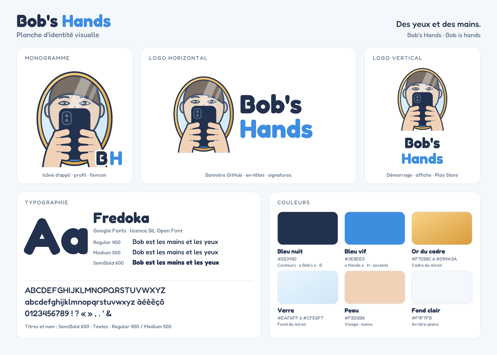

# Identité visuelle de Bob's Hands

  

Ce document décrit l'identité visuelle de Bob's Hands : le logo, ce qu'il raconte, la police, les couleurs et les règles pour les utiliser. Tous les fichiers sont dans [`assets/pictures/branding/`](assets/pictures/branding/).

---

## 1. Le logo

### Ce qu'il montre

Un **miroir ovale** à cadre doré. Dans le miroir, le **reflet d'une personne** : un visage humain sans traits distinctifs, un « Monsieur Tout-le-Monde » dans lequel chacun peut se reconnaître. Devant le miroir, bien réels, **un téléphone et deux mains** qui le tiennent.

Le téléphone cache le bas du visage. Seuls les **yeux** dépassent, baissés vers l'écran.

### Ce qu'il raconte

- **L'utilisateur ne peut pas tenir son téléphone.** Quand il le regarde, il y voit **Bob** : son reflet, qui tient le téléphone et le manipule à sa place.
- **De Bob, on ne voit que des yeux et des mains.** Les yeux regardent l'écran : c'est ce que Bob voit pour la personne. Les mains tiennent et manipulent le téléphone : c'est ce que Bob fait pour elle. C'est exactement la promesse de l'application.
- **Le nom se lit de deux façons.** *Bob's Hands*, « les mains de Bob ». Et *Bob is hands*, « Bob **est** des mains ». Bob n'a pas seulement des mains : il **est** les mains de la personne.
- **L'utilisateur reste au centre.** Son visage occupe le miroir et il est à l'échelle du téléphone : il ne regarde pas passivement, il **interagit**. Bob n'est pas quelqu'un d'autre, c'est son reflet, une extension de lui-même.
- **Un miroir, c'est aussi une fenêtre** : on y voit le monde autant que soi-même.

### Le pourquoi du comment

Le logo est né par étapes, le 12 octobre 2026 au soir :

1. **Le petit robot** (pistes rejetées). Un premier jet reprenait le personnage « petit robot ». Rejeté : Bob n'est pas qu'un petit assistant. C'est celui qui redonne de la mobilité, de l'espoir, une fenêtre sur le monde. Et le robot n'est qu'un des personnages possibles.
2. **Les symboles** (pistes rejetées). L'envol (des mains qui libèrent un oiseau), la fenêtre (des volets ouverts sur un lever de soleil), la voix (un soleil dont les rayons sont une onde sonore). Justes, mais trop génériques.
3. **Le croquis de Gianny.** Une silhouette, deux yeux, et des mains qui tiennent un téléphone. Les mains manipulent le téléphone, les yeux sont ceux de Bob : ils représentent ce que Bob voit.
4. **Un visage humain.** La silhouette devient un visage humain sans traits distinctifs, pour que chacun puisse s'y voir.
5. **Le miroir.** Idée décisive : Bob est le **reflet** de l'utilisateur dans son téléphone. Le visage passe dans le miroir, les mains et le téléphone restent dehors, au premier plan.
6. **Les ajustements.** Le téléphone cache le visage sauf les yeux. Le miroir occupe presque toute la hauteur. Le visage est agrandi pour être à l'échelle du téléphone. La pupille ne dépasse jamais le bord de l'œil. Le monogramme BH signe le coin inférieur droit.

L'historique complet des pistes est conservé dans `assets/pictures/branding/propositions*/`.

### Les trois versions

| Version | Fichiers | Usage |
|---|---|---|
| **Monogramme** | `logo-monogramme.svg`, `.png` (1024 px), `-512.png` | Icône de l'application, photo de profil, favicon. Le symbole seul, signé **BH** en bas à droite. |
| **Horizontal** | `logo-horizontal.svg`, `.png` | Bannière GitHub, en-têtes, signatures. Miroir à gauche, nom à droite sur deux lignes. |
| **Vertical** | `logo-vertical.svg`, `.png` | Écran de démarrage, affiche, fiche Play Store. Miroir au-dessus, nom centré en dessous. |

### Règles d'usage

- **Ne pas déformer** le logo (ni étirer, ni écraser) : toujours garder ses proportions.
- **Ne pas changer les couleurs** du miroir, du visage ou des mains.
- **Ne pas séparer** les mains et le téléphone du miroir : c'est leur rapport qui porte le sens.
- **Laisser respirer** : garder autour du logo une marge libre au moins égale à la hauteur du « B » de « Bob's ».
- **Taille minimale** : le monogramme reste lisible à partir de 48 px ; en dessous, les yeux disparaissent. Pour les très petites tailles (favicon 16 ou 32 px), une version simplifiée sera à prévoir.
- **Fond** : le logo est pensé pour un fond clair. Une version pour fond sombre reste à créer.

---

## 2. La typographie

### Fredoka

| | |
|---|---|
| **Police** | Fredoka |
| **Source** | Google Fonts |
| **Licence** | SIL Open Font License : libre, gratuite, utilisable dans l'application et sur le Play Store |
| **Style** | Arrondie, généreuse, chaleureuse |

**Pourquoi Fredoka ?** Ses formes rondes et ses traits épais sont doux et rassurants, comme Bob. Elle est très lisible, y compris pour les personnes malvoyantes. Et elle est gratuite et libre, ce qui colle au principe « gratuit pour toujours » du projet.

### Les graisses

En typographie, la **graisse** est l'épaisseur des traits d'une police. C'est de là que vient le « caractère gras ».

| Graisse | Usage |
|---|---|
| **SemiBold 600** | Nom de l'application, titres |
| **Medium 500** | Sous-titres, étiquettes, textes mis en avant |
| **Regular 400** | Textes courants |

### Dans le logo

- « **Bob's** » en SemiBold, bleu nuit.
- « **Hands** » en SemiBold, bleu vif. Le bleu vif fait écho aux mains du dessin : c'est la deuxième lecture, *Bob is hands*.
- Le monogramme reprend la même logique : **B** en bleu nuit, **H** en bleu vif.

### Note technique

Les fichiers SVG contiennent du texte en Fredoka : il faut installer la police pour les ouvrir avec le bon rendu. Les fichiers PNG sont déjà rendus et s'utilisent tels quels.

---

## 3. Les couleurs

| Couleur | Code | Rôle | Pourquoi |
|---|---|---|---|
| **Bleu nuit** | `#22314D` | Contours, « Bob's », B, téléphone | Profond et posé : la confiance, la stabilité. Plus doux qu'un noir pur. |
| **Bleu vif** | `#3E8EE0` | « Hands », H, accents, pull | L'énergie, l'action, les mains qui agissent. La couleur de ce que Bob fait. |
| **Or du cadre** | `#F7D58C` à `#D99A3A` | Cadre du miroir | La chaleur, la valeur, et la lumière de l'aube : l'espoir. |
| **Verre** | `#EAF6FF` à `#CFE6F7` | Fond du miroir | La transparence, la clarté. On voit à travers, on se voit dedans. |
| **Peau** | `#F2D2B6` | Visage, mains | Une teinte humaine, douce et neutre. |
| **Fond clair** | `#F4F7FB` | Arrière-plans | Un blanc légèrement bleuté, reposant pour les yeux. |

**Accessibilité** : le bleu nuit sur fond clair offre un contraste très élevé, adapté aux personnes malvoyantes. Le bleu vif est réservé aux grands textes et aux accents, pas aux petits textes.

---

## 4. Le lien avec les personnages

Le logo représente **l'utilisateur et Bob réunis**. Les personnages animés (petit robot, chat, voiture, JARVIS…) sont **l'apparence que Bob prend** dans l'application, au choix de chacun. Ils partagent la même palette et le même trait, des contours bleu nuit épais et des formes rondes, pour que l'ensemble reste cohérent. Voir [docs/APPARENCE.md](docs/APPARENCE.md).

---

## 5. Fichiers et sources

| Fichier | Contenu |
|---|---|
| `assets/pictures/branding/logo-*.svg` / `.png` | Les trois logos officiels |
| `assets/pictures/branding/brand-board.svg` / `.png` | La planche d'identité visuelle |
| `tools/branding/logo_v5.py` | Génère le logo officiel (série du miroir) |
| `tools/branding/logo_v3.py` | Contient le personnage : visage, yeux, téléphone, mains |
| `tools/branding/logo_v4.py` | Contient le verre et le cadre du miroir |
| `tools/branding/brand_board.py` | Génère la planche d'identité visuelle |

Tout est généré par code : pour changer une couleur ou une proportion, on modifie le script et on relance. Tous les fichiers sont recréés d'un coup.

## 6. Reste à faire

- [ ] Icône Android adaptative, à partir du monogramme
- [ ] Version du logo pour fond sombre
- [ ] Version simplifiée pour les très petites tailles (favicon)
- [ ] Bannière de présentation pour le Play Store

---

*Idée originale et croquis du logo : Gianny (Nanou).*
